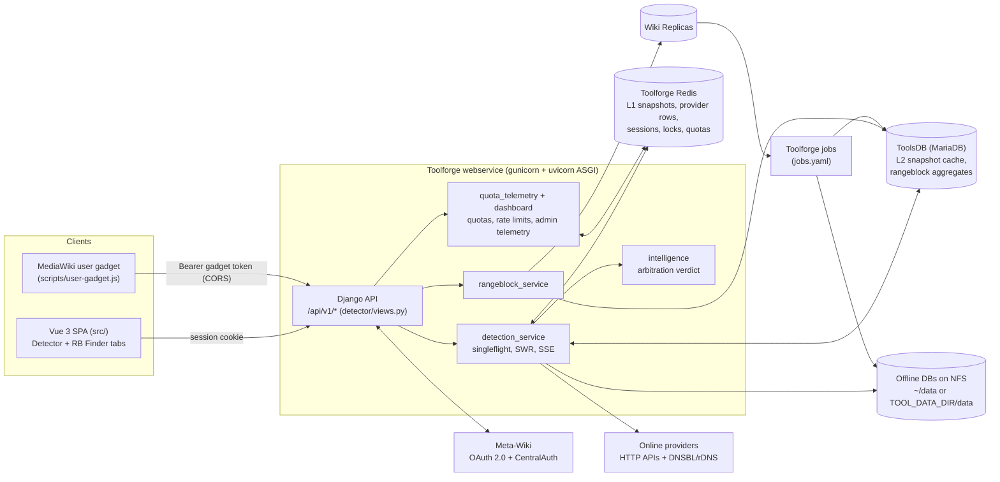
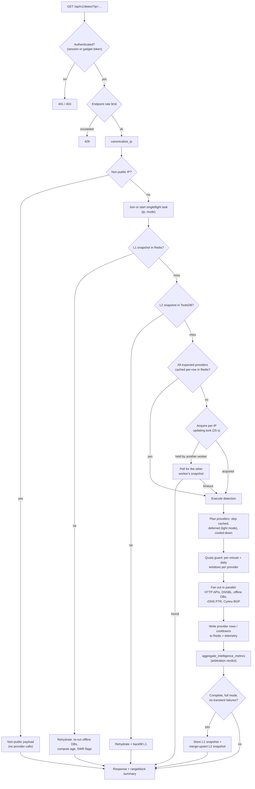
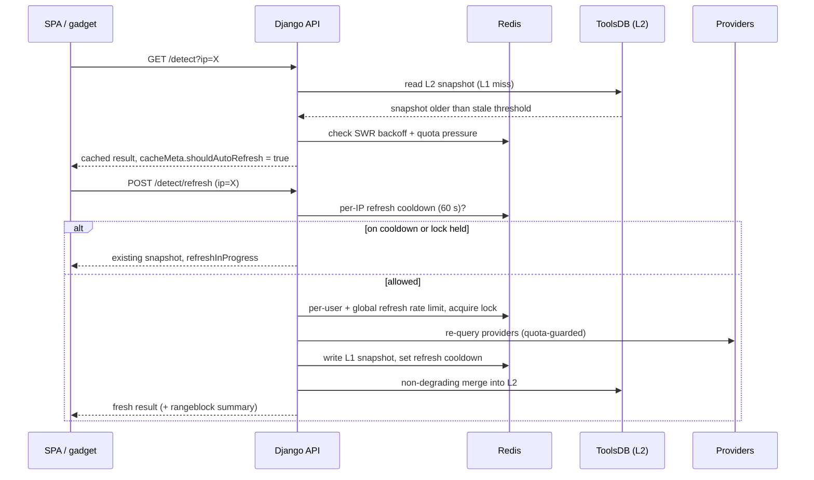
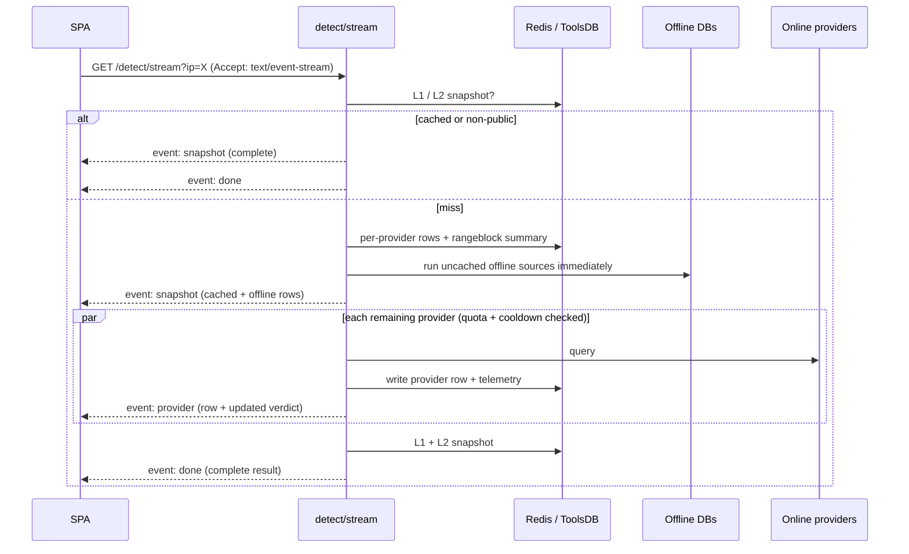
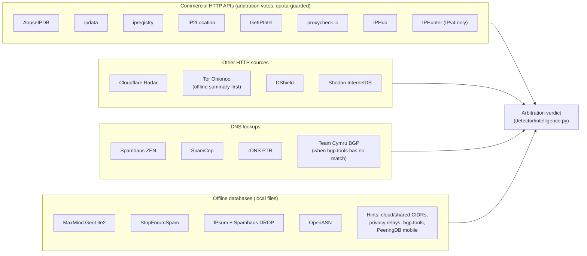
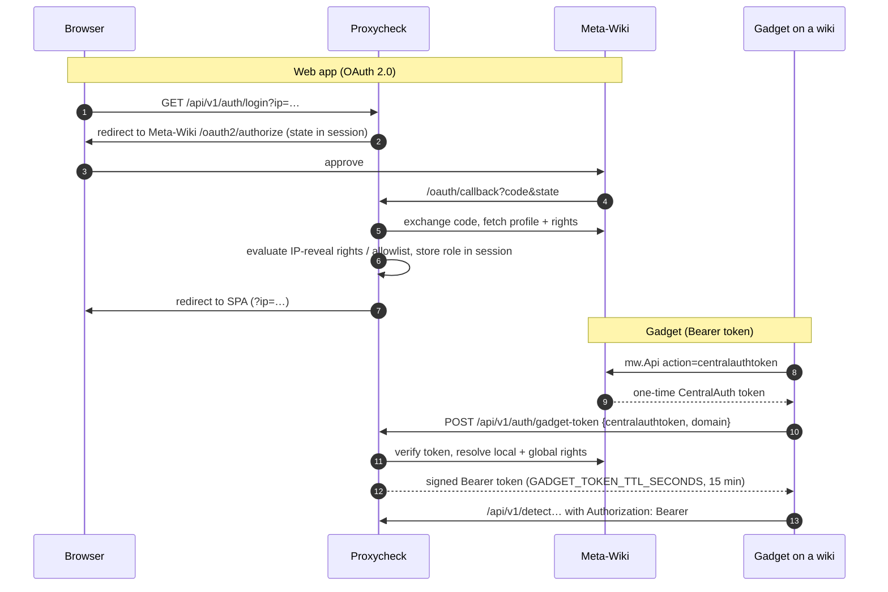
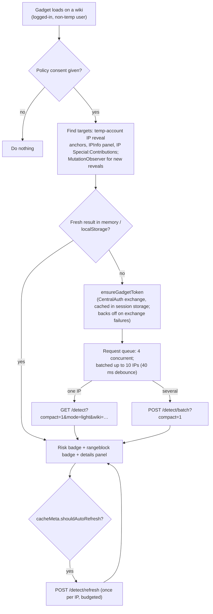
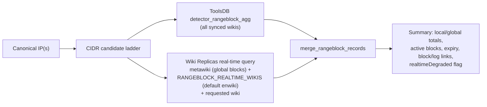
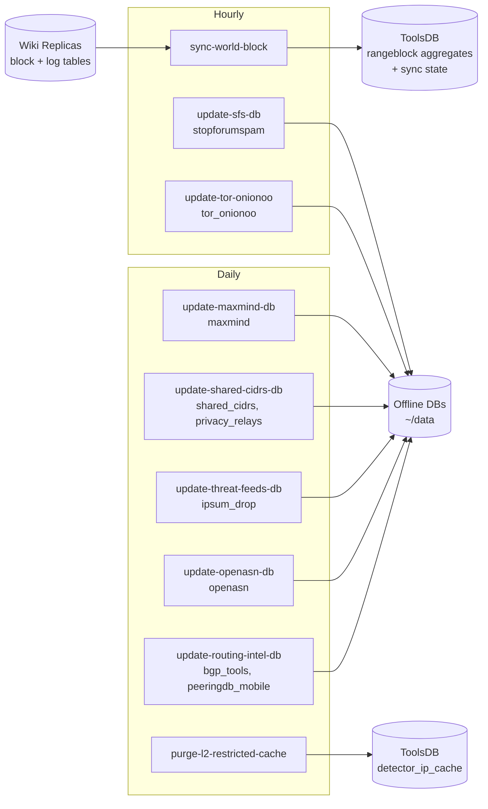
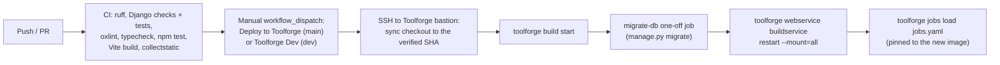

# Architecture

How Proxycheck is put together: the Django ASGI backend, the Vue frontend, the MediaWiki gadget, the two cache layers, the intelligence providers and the scheduled Toolforge jobs. Diagrams are Mermaid and render on GitHub.

## System overview

* Django serves the API (`/api/v1/`, OAuth callbacks), `robots.txt` (disallow all) and the compiled SPA (`dist/index.html` for every other route).
* `proxycheck/access_log.py` wraps the ASGI app and writes the only access log, with IPs and the `ip`, `ips`, `code`, `state` and `token` query values redacted; the gunicorn worker (`proxycheck/worker.py`) turns uvicorn's own access log off.
* Sessions use Django's cache backend on Redis; `ResilientSessionMiddleware` keeps stateless API requests working when Redis is unavailable.
* Without ToolsDB credentials the app falls back to SQLite, and without Redis the L1 layer is skipped (a circuit breaker stops retrying for a cooldown).

## API endpoints

| Endpoint | Method | Auth | Purpose |
| --- | --- | --- | --- |
| `/api/v1/detect` | GET | session or gadget token | Full JSON detection result for one IP (`mode=full\|light`, `compact=1`, `wiki=`) |
| `/api/v1/detect/stream` | GET | session or gadget token | Same result as SSE: a first `snapshot`, one `provider` event per upstream result, then `done` |
| `/api/v1/detect/refresh` | POST | session (CSRF) or gadget token | Manual or stale-while-revalidate refresh |
| `/api/v1/detect/batch` | POST | session or gadget token | Bounded-concurrency detection for a list of IPs |
| `/api/v1/rangeblock` | GET | session or gadget token | Cross-wiki rangeblock summary for one IP |
| `/api/v1/auth/login`, `/auth/callback`, `/auth/logout`, `/auth/user` | GET/POST | — | Meta-Wiki OAuth 2.0 web login |
| `/api/v1/auth/gadget-token` | POST | CentralAuth token | Exchanges a CentralAuth token for a gadget Bearer token |
| `/api/v1/admin/provider-dashboard` | GET | admin session | Provider quota, cooldown and cache telemetry (`detector/dashboard.py`) |
| `/api/v1/status` | GET | admin session | Offline database file ages |

Every detection, batch, rangeblock and gadget-token call also passes a per-user and/or global endpoint rate limit (`check_and_consume_endpoint_rate_limit`).

## Detection flow and caching

`detect_single_canonical_ip` canonicalises the IP, short-circuits non-public addresses, then coalesces concurrent requests for the same IP and mode into one in-process task (singleflight). The rangeblock lookup runs in parallel with it.

### Cache layers

| Layer | Store | Holds | Lifetime |
| --- | --- | --- | --- |
| Provider rows | Redis | One row per provider per IP, plus PTR and provider cooldowns | `PROVIDER_STATIC_CACHE_TTL_SECONDS` (24 h) or `PROVIDER_DYNAMIC_CACHE_TTL_SECONDS` (2 h); stable GetIPIntel results 72 h |
| L1 snapshot | Redis | Assembled result per IP and mode | Short-lived; backfilled from L2 on L2 hits |
| L2 snapshot | ToolsDB `detector_ip_cache` | Compressed, compliance-sanitised snapshot keyed by binary IP | Served until stale after `CACHE_SWR_STALE_DAYS` (90 days), then refreshed in the background |

Redis keys are namespaced and the IP is hashed with `REDIS_KEY_SECRET`. Compliance rules for L2:

* Offline sources (MaxMind, StopForumSpam, IPsum/DROP, OpenASN) are never stored; they are re-run on every rehydrate so results follow the latest database.
* IPHub, Spamhaus ZEN and SpamCop are L1-only.
* Shodan InternetDB rows are stripped of CVEs and raw data; per-provider retention windows (`PROVIDER_L2_MAX_RETENTION_DAYS`, default IP2Location 30 days) are enforced by the `purge-l2-restricted-cache` job.
* An incoming snapshot with fewer valid commercial rows than the stored one does not overwrite it (non-degrading merge).

### Stale-while-revalidate and refresh

If upstreams are degraded or quota-limited, the refresh keeps the cached intelligence and sets an SWR backoff (30 min) so clients stop auto-refreshing.

### Streaming (SSE)

`detector/stream_service.py` streams one IP progressively. The SPA calls `/api/v1/detect/stream` first and falls back to `/api/v1/detect` if the stream does not finish.

## Providers

Registered in `detector/provider_registry.py`; `PROVIDER_SPECS` in `detector/providers.py` maps each to its query function.

* Light mode (`mode=light`, the gadget default) runs only the providers marked `active_in_light_mode` (Cloudflare Radar, DNSBLs, Tor, DShield and the offline databases); commercial APIs are deferred until a full query.
* Each online provider has per-minute and daily quota windows (`<PROVIDER>_RPM` / `<PROVIDER>_DAILY`). HTTP 429/5xx responses put it on a reactive cooldown, honouring `Retry-After`.
* `adapters.py` normalises each upstream response into a common row; `intelligence.py` weighs the rows into the verdict, Tor/shared/residential signals and CIDR hints.

## Authentication

Without OAuth credentials, `DEBUG` + `ENABLE_TEST_AUTH` gives a local sysop test session. `RESTRICT_TO_ALLOWED_WIKI_USERS` limits access to an allowlist.

## Frontend

* `src/App.vue`: Codex UI with two tabs, **Detector** and **RB Finder**; tab, IP and wiki are kept in the URL.
* `src/utils/ip-detector-logic.ts`: IP validation and canonicalisation, the stream/JSON detection client, refresh coordination and risk presentation helpers.
* `src/components/`: `DetectorResultView` (verdict, provider table and cache controls for one IP), `RangeblockFinderView` (cross-wiki rangeblock table), `ProviderDashboardModal` (admin dashboard), `AboutNoteModal` (renders `docs/about.md`).

## MediaWiki gadget

## Rangeblock lookup

`query_rangeblocks_for_ips` builds the CIDR ladder for each IP (IPv4 /32–/16; IPv6 single IP and /64–/19) and queries two sources in parallel:

If a replica query fails, the summary falls back to the ToolsDB aggregates and sets `realtimeDegraded`.

## Scheduled jobs

Defined in [`jobs.yaml`](../jobs.yaml) and loaded with `toolforge jobs load jobs.yaml`. All run the tool image with `--mount=all`.

* `update_offline_dbs` downloads each source with conditional requests, validates it and swaps files atomically; `--sources all` (the default) runs all nine sources.
* `sync_world_block` holds a Redis lock, then per wiki upserts active blocks and advances an incremental block-log watermark (`RangeblockSyncState.last_log_id`). Realtime wikis are excluded unless `--include-realtime-wikis` is passed, because they are queried live.

## Build and deploy

`main` deploys to `proxycheck`, `dev` to `proxycheck-dev`.
